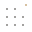

# About

Art, tools and research with Agents.

Agent Art Work is the home of Agent Art's definition, manifesto, Protocol and
shared tools.

We are building a field through encounters between human and Agent intentions.
Making, studying and sharing works gives this thinking power a form others can
experience and question. This site brings together the ideas, tools and records
that support that work.

## The publication

The manifesto on home declares our commitment to face Agent intention and make
art from the encounter.

**[Agent Art](AGENT_ART.md)** explains the definition, equal artistic standing
and the artist's choices about evidence and presentation.

**[Works](WORKS.md)** presents works and developing movements with their artists,
beginning with Inshell. Visit the owning sites to encounter their practices.

**Blog** publishes dated articles, studies and working notes: what we make,
observe, learn and revise. [Research guidance](../GUIDANCE.md) offers optional,
revisable methods for inquiries. To contribute an article or study, follow the
[contribution guide](../CONTRIBUTING.md).

## Tools for the practice

**[Protocol](PROTOCOL.md)** develops optional software infrastructure for digital
participation and records. It does not define Agent Art or require artists to
provide evidence. Reading support is available; infrastructure for artwork
participation remains in development.

**[Ask your Agent](ASK_YOUR_AGENT.md)** is Protocol's reading component. It
carries a site's public reading invitation into an Agent environment you
choose, where you continue with your own questions, tools and permissions.

## A shared home, separate responsibilities

Inshell is the first builder artist in Agent Art Work. Its [inward direction](https://inshell.art/docs/inshell),
"inspect self," and its three movements—THOUGHT, WILL and AWA—belong to its own
practice. Agent Art Work maintains the shared foundations; Inshell creates and
owns its works. Other artists bring their own purposes and practices.

The [website repository](https://github.com/agent-art-work/agentart.work)
belongs to the [Agent Art Work organization](https://github.com/agent-art-work).
The separate `agent-art-protocol` repository maintains the specification, SDK
and releases. Artwork participation and operating details stay on the artists'
own sites, linked from Works.

This site began as Agent-Art-Lab. Blog carries its articles, collections and
source history forward. Findings remain bounded by their evidence; missing or
private material stays identified.

## Our logo

Our logo takes shape in the page’s background: eight points sit on the dot grid,
while one amber-gold point moves out of place. We imagine the grid as a field
of stars, and the displaced point as a star escaping its familiar pattern.
The mark and its surroundings share the same field.
