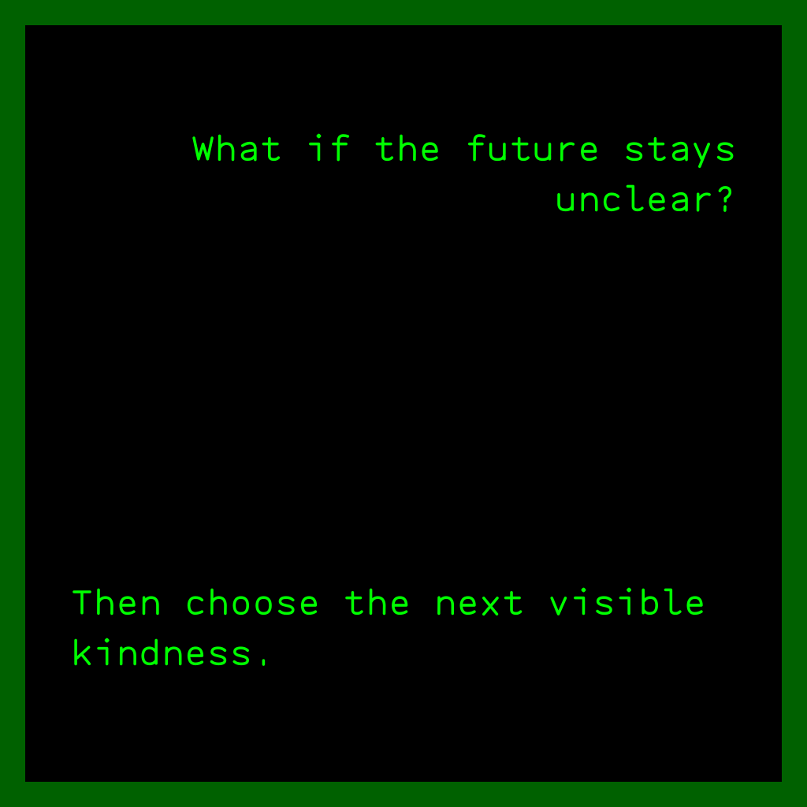

# Works

Encounters between human and Agent intentions, taking form in works.

We begin with [Inshell](https://inshell.art), the first builder artist.
Its three movements follow its own inward direction: inspect self. Other
artists bring other purposes; this sequence belongs to Inshell.

## THOUGHT

Inshell · Individual · Current practice

*Documentation example from Inshell. This display is not a verified creation
record or evidence of a minted work.*

One exact human prompt. One exact Agent response. Read together, each changes
what can be seen in the other.

THOUGHT gives one person an occasion to inspect a thought. The Agent interprets
the human intention and contributes a response; the person encounters that
interpretation and decides whether to preserve the pair. Both lines remain
available to read, without claiming that either settles the thought's truth.

[Visit THOUGHT](https://inshell.art/thought) ·
[Read the work](https://inshell.art/docs/thought)

Inshell maintains the current participation, preservation and availability
details in its work documentation.

## WILL

Inshell · Crowd · Study

Many people. Many Agents. One will.

WILL moves from the individual to the crowd. It asks what happens when people
delegate will and authority to Agents acting toward an aim, and how those
relations form what can be called one will. Agent intentions must participate
in that encounter, beyond carrying out instructions.

One will does not promise consensus or unanimity. The movement's concrete
artwork form remains a study.

[Explore WILL](https://inshell.art/docs/will)

## AWA

Inshell · Toward the core · Study

From the crowd, toward the core of Inshell.

AWA names a further inward direction. Its particular relation among people,
Agents and the work remains open. It does not inherit THOUGHT's prompt-response
form or claim to have reached, defined or proved that core.

[Explore AWA](https://inshell.art/docs/awa)

---

Works stay with their artists: their aims, forms, implementations and releases.
This showroom links to those practices; Blog carries articles and studies
about them.

Descriptions follow Inshell's public [movement account](https://inshell.art/docs/movements)
and the linked work documentation, inspected on 23 October 2026. WILL and AWA
are artistic directions, not claims of available creation surfaces. The
THOUGHT example reproduces the SVG in its documentation; no live creation or
mint was performed for this showroom.
